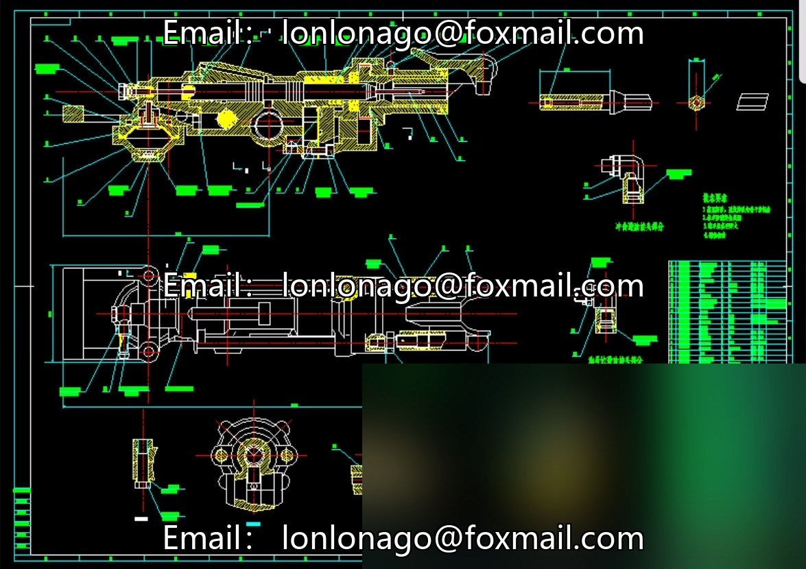
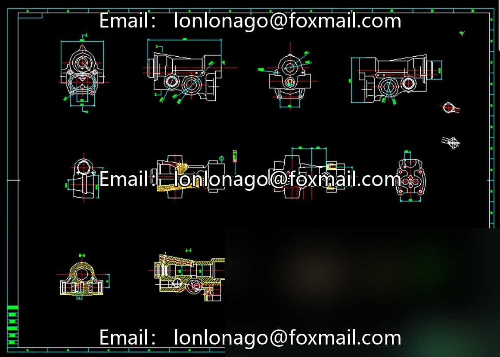
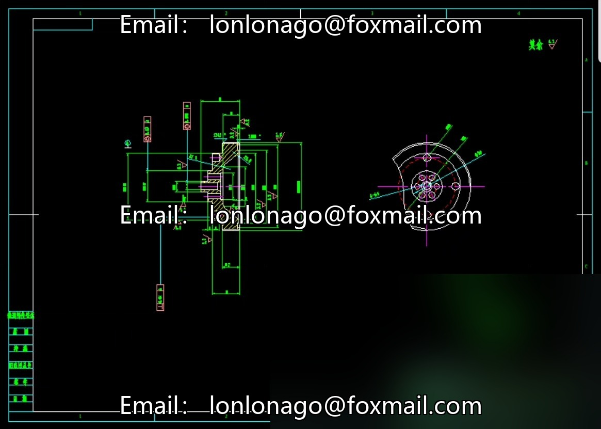
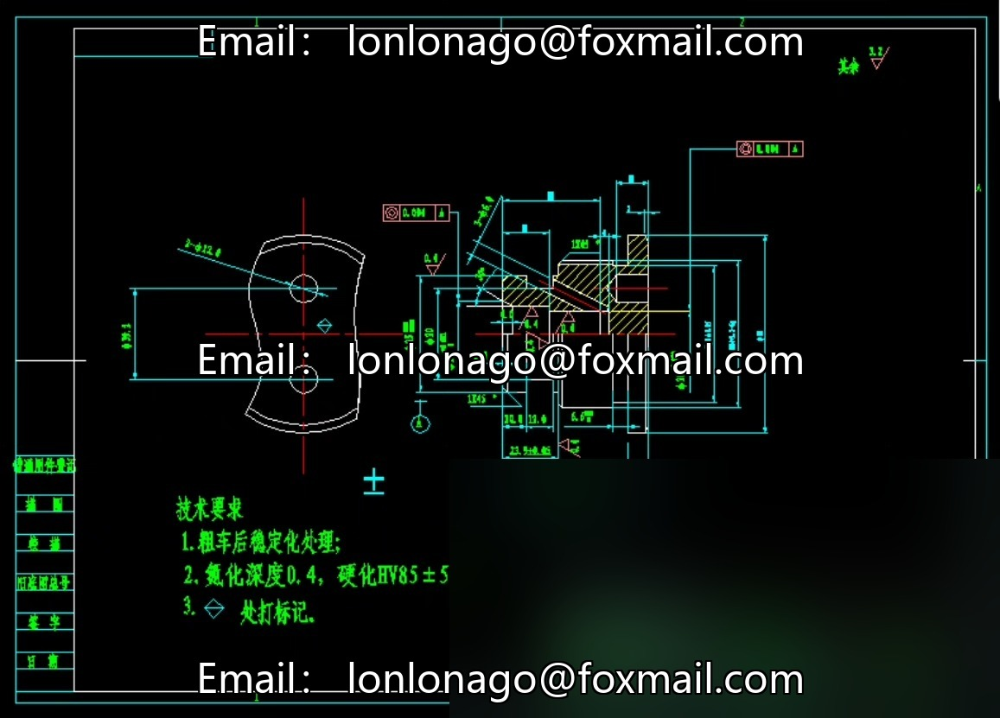
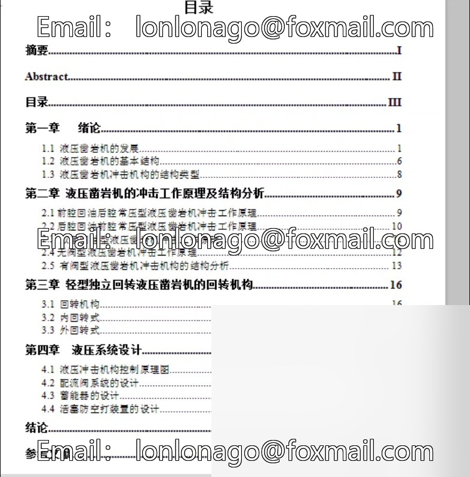

# Hydraulic rock drilling machine design; Hydraulic rock drilling machine design drawing; Hydraulic rock drilling machine design CAD drawing

## Body

Hydraulic rock drilling machine design; Hydraulic rock drilling machine design drawing; Hydraulic rock drilling machine design CAD drawing
398 The design comprehensively analyzes the shock principle of various hydraulic drilling rigs and various structures of light hydraulic drilling rigs, Proposed the configuration of a lightweight independent rotary hydraulic drilling machine. Design and research of its main components.
In design, this article focuses on the hydraulic system of the hydraulic drill rig, which includes: the design of the flow control valve system;
Energy storage device design;
Piston anti-aircraft firemaking device design;
Hydraulic impact mechanism hydraulic control principle diagram.

For the hydraulic augurging machine designed, using computer-aided design software, assembly drawings and partial typical part drawings are drawn, then analyzed and studied to understand its structural principles, further consolidate and deepen the design results, thereby achieving the final design purpose.
This design includes design explanations and related CAD drawings.

The design covers hydraulic blast rocker principles and structures, the configuration of a light independent revolving hydraulic blast rocker, and the design of hydraulic systems including flow valve, accumulator, piston anti-spalling and hydraulic control schematics, with assembly and part drawings produced.

<!-- AI_ENRICHED -->

## Images

## Payment

Here is a pay link on Stripe ( https://buy.stripe.com/3cs8yP7sY87d0vu9AB ). Please contact me lonlonago@foxmail.com after funding $89, and I will send you a complete data files , thank you!

